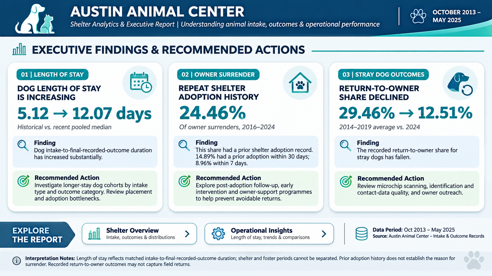
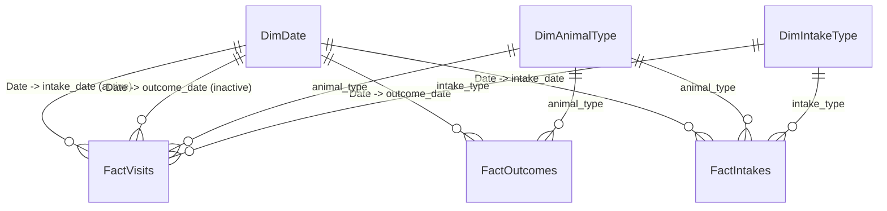

# Austin Animal Center Analytics

A data analytics and Power BI case study built on the City of Austin's public Austin Animal Center intake and
outcome records. The project audits the source data, reconstructs shelter **visits** from separate intake and
outcome events, and presents a three-page Power BI report showing how animals come in, what happens to them and
where shelter leadership could act.



*Executive Summary page background used in the Power BI report (`assets/images/executive-summary-background.png`).*

---

## 1. Business objective

The brief is set out from a shelter director's perspective:

> *How do animals come in, what happens to them, and where should we act?*

The required deliverable is one Power BI report with a data model linking intakes to outcomes (with a date
table), length of stay per visit as a measure, a trend with a year-over-year comparison, slicers for animal type,
intake type and date, and three findings the director should act on (`DECISION_LOG.md` §2).

**Guiding principle:** analytical correctness, traceability and business usefulness take priority over
decorative complexity. Every reported figure is reproducible from the scripts and documented definitions.

## 2. Context and source data

Austin Animal Center is the City of Austin's municipal animal shelter, operated by Austin Animal Services. The
City publishes intake and outcome records on its open-data portal:

| Dataset | Portal URL | File in `data/raw/` | Rows | Coverage |
|---|---|---|---:|---|
| Intakes | https://data.austintexas.gov/api/views/wter-evkm/rows.csv?accessType=DOWNLOAD | `Austin_Animal_Center_Intakes__10_01_2013_to_05_05_2025_.csv` | 173,812 | 01-10-2013 07:51 to 04-05-2025 23:44 |
| Outcomes | https://data.austintexas.gov/api/views/9t4d-g238/rows.csv?accessType=DOWNLOAD | `Austin_Animal_Center_Outcomes__10_01_2013_to_05_05_2025_.csv` | 173,775 | 01-10-2013 09:31 to 05-05-2025 07:22 |

* **The source extract ends on 5 May 2025.** 2013 (from 1 October) and 2025 (to 5 May) are **partial years**
  and are never compared directly with complete years; like-for-like windows are used instead.
* The raw files are read-only; their SHA-256 values are recorded in `data/reference/source_checksums.csv` and
  checked by the audit script and the tests.
* Dates in this repository are displayed as `DD-MM-YYYY`; stored data keeps genuine date/datetime types.

## 3. Business questions

1. How much demand arrives, by type and season, and how has it changed (including the 2020 break)?
2. What happens to animals — adoption, return to owner, transfer, euthanasia — at the **visit** level?
3. How long do animals take to reach a final outcome, and which groups take longest?
4. Which patterns point to actions the shelter controls (returns after adoption, reunification, long stays)?

Fifteen candidate opportunities were scored on relevance, data availability, reliability, depth, actionability
and interpretation risk (`docs/BUSINESS_OPPORTUNITY_REGISTER.md`). The top eight were owner surrender patterns,
intake volume and seasonality, adoption outcomes, length of stay, return-to-owner outcomes, intake-to-outcome
throughput, stray intake patterns and age-based outcomes. Breed-level analysis was deliberately not recommended
(unreliable visual labels and stigma risk).

## 4. Data cleaning and duplicate handling

Implemented in `analysis/common.py` and `analysis/audit_datasets.py`; full results in
`docs/DATA_AUDIT_REPORT.md` and `docs/DATA_QUALITY_ISSUES.md` (31 issues).

* All columns are read as text and typed explicitly; parse failures are counted, not silently coerced.
* **Timestamps are source-local wall-clock time.** 3,584 outcome rows carry a `-05:00` suffix, all at exactly
  midnight and including winter dates when Austin is `-06:00`; the offset is treated as metadata, never applied
  (D-008).
* **Exact duplicate rows** (36 intake, 26 outcome excess copies) are flagged and excluded from analysis, leaving
  **173,776 intake events** and **173,749 outcome events** (D-009). Same-ID/same-timestamp rows that differ in
  another field are kept and flagged; repeat intakes for an animal are treated as legitimate repeat visits.
* Negative ages, `NULL` tokens, dates of birth after the outcome date and overlapping category labels are flagged,
  not deleted. Category labels are kept as recorded.
* Unique Animal IDs: 156,287 in intakes and 156,237 in outcomes.

## 5. Event preparation and visit matching

`Animal ID` is not a visit key — an animal can come in many times (one has 33 intakes) and neither file has a
visit number. Visits are reconstructed in `analysis/matching_engine.py` / `analysis/match_visits.py`;
method and evidence in `docs/VISIT_MATCHING_METHODOLOGY.md`.

> **Rule (D-010, D-011, D-018):** a visit starts at an intake and ends at the animal's next recorded outcome,
> provided the animal was not taken in again in between. An outcome stamped exactly midnight carries no time and
> is treated as occurring later that day. An outcome logged *earlier* on the same day than an intake is **not**
> matched; those pairs are kept separately as unconfirmed candidates.

Five methods were compared (derived sequence, FIFO, LIFO, adjacent-event, as-of). The adjacent-event rule is the
only one-to-one method that never produces overlapping visits for an animal and is unaffected by duplicate
removal. Sensitivity scenarios (`outputs/sensitivity/`) change no candidate finding by more than 0.05 percentage
points.

| Visit table (`outputs/matching/candidate_visits.csv`) | Rows |
|---|---:|
| Matched visits | 172,547 |
| Intake without matched outcome | 1,229 |
| Outcome without matched intake | 1,202 |
| **Total candidate visit rows** | **174,978** |

The unmatched rows include the 225 same-day time-reversed candidate pairs (450 events), flagged
`same_day_reversed_candidate` and listed in `outputs/matching/same_day_reversed_candidates.csv`. 172,547 + 1,229
reconciles to 173,776 intake events and 172,547 + 1,202 to 173,749 outcome events.

**Length of stay (LOS)** is the time from intake to the **final recorded outcome** of a matched visit. It is not
shelter-only occupancy: foster placement is not recorded in either file, so time spent in foster care cannot be
separated (D-019). Median 6.00 days, P90 55.56 days, 577 visits over 365 days.

## 6. Data model

Power Query sources: `powerbi/power_query/`; relationships: `powerbi/dax/00_Model_Relationships.md`; full
specification: `docs/POWER_BI_DATA_MODEL.md`.

| Table | Grain | Rows |
|---|---|---:|
| FactIntakes | one analytic intake event (`intake_event_id`), exact duplicates excluded | 173,776 |
| FactOutcomes | one analytic outcome event (`outcome_event_id`), exact duplicates excluded | 173,749 |
| FactVisits | one candidate visit (`visit_id`), unmatched rows retained | 174,978 |
| DimDate | one day, 01-10-2013 to 05-05-2025, continuous | 4,235 |
| DimAnimalType | Dog, Cat, Other, Bird, Livestock | 5 |
| DimIntakeType | Stray, Owner Surrender, Public Assist, Wildlife, Abandoned, Euthanasia Request | 6 |



* All relationships are one-to-many and single-direction; nothing is joined on Animal ID and the facts are not
  related to each other.
* **Date roles:** a date filter means intake date for intake measures, outcome date for outcome measures and
  **intake date (intake cohort)** for visit measures. Outcome-dated visit measures use `USERELATIONSHIP` on the
  inactive relationship.
* Intake type filters intake events and visits; it does not filter outcome events, which have no intake type.

## 7. Power BI report

File: **`powerbi/Austin_Animal_Center_Analytics_Working.pbix`** (the current report; latest update in commit
`af6aca4`). `powerbi/Austin_Animal_Center_Analytics.pbix` (16.7 KB) is the original blank file supplied with the
brief and is kept for history only. Page contents below are taken from the report's readable metadata.

| Page | Purpose | Main content |
|---|---|---|
| **Executive Summary** | Three findings and recommended actions for the director, with navigation to the analysis pages | Page background `assets/images/executive-summary-background.png`; navigation buttons |
| **Shelter Overview** | Intake and outcome volumes and distributions | KPI cards (Total Intakes, Total Outcomes, Matched Visits, Median Intake-to-Outcome Days); monthly trend; outcome-group breakdown; slicers for date, animal type and intake type |
| **Operational Insights** | Length of stay, trends and year-over-year comparison | Median / Average / P90 Intake-to-Outcome Days, Matched Visits; intake volume with `Total Intakes YoY Change %` by year; breakdown by animal type |

## 8. KPIs and DAX measures

DAX source files: `powerbi/dax/01_Core_Measures.dax` … `05_Diagnostics.dax` (DAX-query-view format; each file
ends with an `EVALUATE` reconciliation query). Expected unfiltered values are in
`outputs/powerbi/model_validation_summary.csv`.

| Measure | Definition | Expected (unfiltered) |
|---|---|---:|
| Total Intakes / Total Outcomes | analytic event counts | 173,776 / 173,749 |
| Matched Visits | visit rows with `visit_status = "Matched visit"` (filtered inside the measure) | 172,547 |
| Unmatched Intake / Outcome Events | intake-only / outcome-only visit rows | 1,229 / 1,202 |
| Median / P90 LOS (Days) | intake to final recorded outcome, matched visits (`PERCENTILE.INC`) | 6.00 / 55.56 |
| Same-Day Visits | intake and outcome on the same calendar date | 22,149 |
| Visits Under 24 Hours | LOS < 1 day | 32,417 |
| Total Intakes / Total Outcomes Previous Year, YoY Change, YoY Change % | `SAMEPERIODLASTYEAR` on `DimDate[Date]`; BLANK for 2013, 2014 and 2025 (partial comparison periods) | e.g. 2020 intakes −51.4% |
| Provisional Live / Non-Live / Indeterminate Outcomes | descriptive grouping — **not** Austin's official live-release rate | see summary CSV |
| Zero-Duration / LOS Floored to Zero (Diagnostic) | data-quality diagnostics, not business KPIs | 439 / 416 |

In the report, LOS measures appear as *Median / Average / P90 Intake-to-Outcome Days* in the `DAX_Measures`
table; they correspond to the LOS measures above (see `docs/POWER_BI_DATA_MODEL.md` §11.1 for the
reconciliation check).

## 9. Key findings and recommendations

Descriptive findings from the validated primary visit dataset (`outputs/sensitivity/scenario_comparison.csv`,
scenario `A_excl_reversed`; `outputs/analysis/`). They describe recorded patterns and **do not establish
causes**.

**1 — Dog time to final outcome has more than doubled.** The pooled median intake-to-final-recorded-outcome
duration for dogs rose from **5.12 days** (2014–2019 intake cohorts) to **12.08 days** (2023–2024). For dog
visits whose outcome has no foster subtype, the pooled median rose from 4.95 to 8.94 days and the share over 30
days from 8.67% to 22.58%. This is custody time to the final outcome, not shelter-only occupancy.
*Recommended action:* investigate longer-stay dog cohorts by intake type and outcome category and review
placement and adoption bottlenecks.

**2 — About one in four owner surrenders was previously adopted from the shelter.** Of 27,256 owner-surrender
visits in 2016–2024, **24.46%** had a prior shelter adoption record (the animal's preceding matched visit ended in
adoption); **14.89%** had that adoption within the previous 30 days and **8.96%** within 7 days. A prior adoption
does not establish the reason for surrender. *Recommended action:* explore post-adoption follow-up, early
intervention and owner-support programmes to help prevent avoidable returns.

**3 — The recorded return-to-owner share for stray dogs has fallen.** **29.46%** of stray-dog visits ended in
return to owner on average across 2014–2019 intake years, versus **12.51%** in 2024. Returns made in the field
without an intake are not in the data, so the share describes sheltered animals only. *Recommended action:*
review microchip scanning, identification and contact-data quality, and owner outreach.

Supporting context: full-year intake events averaged 18,216 (2014–2019) and 11,643 (2022–2024), with a level
shift from March 2020 whose cause is not identifiable from the data; intakes peak in May.

> **Note on the Executive Summary image.** The background shows the dog figure as "5.12 → 12.07 days". The
> current primary dataset gives **12.08** (12.07 was the pooled figure before the 225 time-reversed pairs were
> excluded, DECISION_LOG D-018). The difference is 0.01 day; update the image text if exact agreement is required.

## 10. Caveats and limitations

* LOS is intake-to-final-recorded-outcome duration, not kennel time; foster periods cannot be separated (D-019).
* 2013 and 2025 are partial years; the extract ends 05-05-2025 and recent cohorts are mildly right-censored.
* The provisional live/non-live grouping is not the City's official live-release rate (formula unverified).
* "Transfer" includes community-cat return programmes, not only partner placements.
* 225 same-day time-reversed pairs and 45 animals with method-dependent pairings cannot be resolved from the
  extract; they are flagged, and excluding them changes no finding materially.
* Field activity without an intake record is invisible to the data.
* DAX measures were validated by an equivalent Python computation against the CSV outputs, **not executed in
  the Power BI engine** from this repository; see §12 for the checks to run in Power BI Desktop.

## 11. Repository structure

```text
Austin_Animal_Center_Analytics/
├── README.md · CHANGELOG.md · DECISION_LOG.md · CLAUDE.md · requirements.txt
├── analysis/                  # Python pipeline: common, matching_engine, audit_datasets, match_visits,
│   │                          # explore_business_opportunities, sensitivity_analysis,
│   │                          # validate_powerbi_model, run_all
│   └── tests/                 # pytest suite
├── assets/images/             # executive-summary-background.png
├── data/
│   ├── raw/                   # original source CSVs (read-only)
│   ├── processed/             # cleaned intake and outcome event tables
│   └── reference/             # source checksums
├── docs/                      # audit report, data dictionary, matching methodology, data-quality register,
│                              # business opportunity register, Power BI data model
├── outputs/
│   ├── audit/ · matching/ · analysis/ · sensitivity/   # validated pipeline outputs
│   └── powerbi/               # model validation summary, YoY reference values
├── powerbi/
│   ├── Austin_Animal_Center_Analytics_Working.pbix     # current report
│   ├── Austin_Animal_Center_Analytics.pbix             # original blank file (history)
│   ├── power_query/           # M queries (FactIntakes, FactOutcomes, FactVisits, DimDate, DimAnimalType,
│   │                          # DimIntakeType, RepoRoot parameter)
│   └── dax/                   # relationships spec and measure library
├── references/design/         # visual design reference (not project content)
└── presentation/ · website/   # placeholders for later stages
```

## 12. Reproducibility and validation

Requires Python 3.11+ and the packages in `requirements.txt`.

```bash
pip install -r requirements.txt
```

```bash
python analysis/run_all.py
```

`run_all.py` verifies the raw-file checksums, runs `audit_datasets.py` → `match_visits.py` →
`explore_business_opportunities.py` (about 1.5 minutes) and then the pytest suite. Outputs are deterministic.
The sensitivity analysis and the Power BI model validation run separately:

```bash
python analysis/sensitivity_analysis.py
```

```bash
python analysis/validate_powerbi_model.py
```

```bash
python -m pytest analysis/tests -q
```

The model validator checks source files, column lists against the M queries, typing, duplicate exclusion, row
and status totals, keys, LOS, date ranges, dimension domains, DAX references and year-over-year reference values,
and writes `outputs/powerbi/model_validation_summary.csv` and `outputs/powerbi/yoy_reference.csv`.

**In Power BI Desktop** (cannot be checked from the repository): set the `RepoRoot` parameter to your clone; mark
`DimDate` as the date table and turn off Auto date/time; then compare the measures with
`outputs/powerbi/model_validation_summary.csv` (`docs/POWER_BI_DATA_MODEL.md` §11).

## 13. Documentation map

| Document | Contents |
|---|---|
| `DECISION_LOG.md` | Assignment requirements, every analytical decision (D-001 onward), open questions |
| `CHANGELOG.md` | Dated implementation history |
| `docs/DATA_AUDIT_REPORT.md` | Source audit results |
| `docs/DATA_QUALITY_ISSUES.md` | Issue register with treatments |
| `docs/DATA_DICTIONARY.md` | Source and derived columns |
| `docs/VISIT_MATCHING_METHODOLOGY.md` | Matching methods, rules, sensitivity validation |
| `docs/BUSINESS_OPPORTUNITY_REGISTER.md` | Opportunity scoring and director findings |
| `docs/POWER_BI_DATA_MODEL.md` | Model, relationships, measures, Desktop implementation |

Repository content is intended for the interview exercise; no credentials or private data are stored here.
