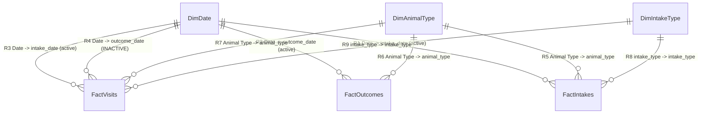

# Power BI Data Model — Stage 1 Foundation

**Status:** Source files for the model are written and validated against the CSV outputs. **No PBIX has
been modified or created**: the queries, relationships and measures below must be loaded into Power BI
Desktop manually (§11). No visuals are built at this stage.

| Artefact | Location |
|---|---|
| Power Query (M) | `powerbi/power_query/RepoRoot.m`, `FactIntakes.m`, `FactOutcomes.m`, `FactVisits.m`, `DimDate.m`, `DimAnimalType.m`, `DimIntakeType.m` |
| Relationships | `powerbi/dax/00_Model_Relationships.md` |
| DAX measures | `powerbi/dax/01_Core_Measures.dax` … `04_Outcome_Analysis.dax`, `05_Diagnostics.dax` |
| Validation | `analysis/validate_powerbi_model.py` → `outputs/powerbi/model_validation_summary.csv`; tests `analysis/tests/test_powerbi_model.py` |

Analytical definitions are unchanged from the audit (DECISION_LOG D-008 to D-019).

---

## 1. Model overview

A star schema with three fact tables and three conformed dimensions (DimDate, DimAnimalType,
DimIntakeType). The facts are **not** related to
each other and nothing is joined on `animal_id`.



All relationships are one-to-many, single-direction (dimension filters fact).

## 2. Tables and grains

| Table | Source (relative to repository root) | Grain / key | Rows | Row rule |
|---|---|---|---:|---|
| FactIntakes | `data/processed/intakes_clean.csv` | one analytic intake event · `intake_event_id` | 173,776 | excludes `is_exact_duplicate = 1` (36 rows) |
| FactOutcomes | `data/processed/outcomes_clean.csv` | one analytic outcome event · `outcome_event_id` | 173,749 | excludes `is_exact_duplicate = 1` (26 rows) |
| FactVisits | `outputs/matching/candidate_visits.csv` (+ reasons from `unmatched_intakes.csv`, `unmatched_outcomes.csv`) | one visit candidate · `visit_id` | 174,978 | **no rows removed** |
| DimDate | generated in M | one calendar day · `Date` | 4,235 | 01-10-2013 to 05-05-2025, continuous |
| DimAnimalType | distinct `animal_type` of the three facts | one animal type · `Animal Type` | 5 | Dog, Cat, Other, Bird, Livestock |
| DimIntakeType | distinct non-null `intake_type` of FactIntakes and FactVisits | one intake type · `intake_type` | 6 | Stray, Owner Surrender, Public Assist, Wildlife, Abandoned, Euthanasia Request |

FactVisits rows by `visit_status`: Matched visit 172,547 · Intake without matched outcome 1,229 · Outcome
without matched intake 1,202. Of the unmatched rows, 450 (225 intake-only + 225 outcome-only) are the
same-day time-reversed candidate pairs, kept unmatched in the primary dataset (D-018) and flagged
`same_day_reversed_candidate = true`. No FactVisits row is dropped for a missing date: outcome-only rows
have no `intake_date` and intake-only rows have no `outcome_date` by construction.

`outputs/sensitivity/scenario_comparison.csv` is a reference for sensitivity figures only; it is not
loaded into the model.

## 3. Column roles

| Role | FactIntakes | FactOutcomes | FactVisits |
|---|---|---|---|
| Primary key (text) | `intake_event_id` | `outcome_event_id` | `visit_id` |
| Traceability (text / integer) | `source_row`, `animal_id` | `source_row`, `animal_id` | `intake_event_id`, `outcome_event_id`, `animal_id`, `candidate_partner_event_id` |
| Date key → DimDate (Date) | `intake_date` | `outcome_date` | `intake_date` (active), `outcome_date` (inactive) |
| Timestamp (DateTime, wall clock) | `intake_datetime` | `outcome_datetime` (+ `outcome_tz_offset` text, never applied) | `intake_datetime`, `outcome_datetime` |
| Dimension key → DimAnimalType | `animal_type` | `animal_type` | `animal_type` |
| Dimension key → DimIntakeType | `intake_type` | — | `intake_type` (null on outcome-only rows) |
| Categories (kept in the fact) | `intake_type`, `intake_condition`, `sex_upon_intake`, `age_band_intake`, `breed`, `color` | `outcome_type`, `outcome_subtype`, `outcome_group`, `outcome_status_provisional`, `sex_upon_outcome` | `visit_status`, `match_rule`, `los_band`, `intake_type`, `intake_condition`, `outcome_type`, `outcome_subtype`, `outcome_group`, `outcome_status_provisional`, `age_band_intake`, `unmatched_reason`, `unmatched_reason_code` |
| Numeric (decimal) | `age_upon_intake_days` | `age_upon_outcome_days` | `los_days`, `los_days_raw`, `age_upon_intake_days`, `intake_age_dob_gap_days` |
| Integer | `source_row` | `source_row`, `age_from_dob_days` | `animal_intake_ordinal`, `n_eligible`, `days_open_at_extract_end` |
| Flags (true/false) | `is_exact_duplicate`, `is_same_id_timestamp_conflict`, `breed_is_mix`, … | `outcome_is_midnight`, `outcome_time_is_date_only`, `dob_after_outcome`, … | `same_day_visit`, `long_stay_365plus`, `is_return_intake`, `assignment_method_dependent`, `same_day_reversed_candidate`, … |

Full column definitions: `docs/DATA_DICTIONARY.md`. `unmatched_reason_code` is added in `FactVisits.m`
from the reason text: `NO_OUTCOME_RECORDS`, `NO_LATER_OUTCOME`, `SUPERSEDED`, `REVERSED_CANDIDATE`,
`NO_INTAKE_RECORDS`, `NO_EARLIER_INTAKE`, `EXTRA_OUTCOME` (and `LATER_OUTCOMES_ASSIGNED`, unused).

### Power Query rules

* `Csv.Document(..., [Encoding = 65001, QuoteStyle = QuoteStyle.Csv])` — UTF-8, quoted fields.
* `Table.SelectColumns(..., MissingField.Error)` — refresh fails if the source schema changes.
* Blank text → `null` before typing; identifiers stay text.
* Dates and datetimes parsed with explicit ISO formats (`yyyy-MM-dd`, `yyyy-MM-dd HH:mm:ss`, culture
  `en-US` only for the parser) — no locale-dependent guessing and no US-format strings.
* No timezone conversion (D-008); `outcome_tz_offset` stays text.
* Flags `1`/`0` → `true`/`false`; any other value raises an error.
* Sources are referenced as `RepoRoot & "<relative path>"`; `RepoRoot` is a text parameter (§11).

## 4. Relationships and filter propagation

| # | From | To | Cardinality | Direction | Active |
|---|---|---|---|---|---|
| R1 | DimDate[Date] | FactIntakes[intake_date] | 1:* | Single | Yes |
| R2 | DimDate[Date] | FactOutcomes[outcome_date] | 1:* | Single | Yes |
| R3 | DimDate[Date] | FactVisits[intake_date] | 1:* | Single | Yes |
| R4 | DimDate[Date] | FactVisits[outcome_date] | 1:* | Single | **No** |
| R5 | DimAnimalType[Animal Type] | FactIntakes[animal_type] | 1:* | Single | Yes |
| R6 | DimAnimalType[Animal Type] | FactOutcomes[animal_type] | 1:* | Single | Yes |
| R7 | DimAnimalType[Animal Type] | FactVisits[animal_type] | 1:* | Single | Yes |
| R8 | DimIntakeType[intake_type] | FactIntakes[intake_type] | 1:* | Single | Yes |
| R9 | DimIntakeType[intake_type] | FactVisits[intake_type] | 1:* | Single | Yes |

* **DimAnimalType** filters all three facts. Validated: the same five values in all facts, no blanks.
  For visit rows, `animal_type` is the intake animal type (outcome type on outcome-only rows); there are
  0 intake/outcome animal-type mismatches.
* **DimIntakeType** filters FactIntakes and FactVisits (not FactOutcomes, which has no intake type).
  Validated: the same six values in both facts; FactIntakes has no blanks; FactVisits is blank only on the
  1,202 outcome-only rows. No rows are excluded — those rows sit under the relationship's blank member and
  drop out only when a specific intake type is selected. Use `DimIntakeType[intake_type]` for the
  intake-type slicer. Outcome measures (FactOutcomes) are unaffected by it.
* **Other category slicers** placed on a fact column filter only that fact. A conformed outcome-type
  dimension is deferred.
* **Not created:** Animal ID relationships, fact-to-fact relationships (event IDs are traceability only),
  bidirectional or many-to-many relationships.

## 5. Date relationship behaviour

A DimDate filter means a different event date for each family of measures:

| Measures | Date meaning |
|---|---|
| FactIntakes measures (e.g. Total Intakes) | intake date |
| FactOutcomes measures (e.g. Total Outcomes, Adoption Outcomes) | outcome date |
| FactVisits measures (Matched Visits, LOS, operations) | **intake date** (intake cohort) |
| `Matched Visits (by Outcome Date)`, `Unmatched Outcome Events` | outcome date via `USERELATIONSHIP` (R4) |

So "March 2020" shows intakes received in March, outcomes recorded in March, and visits/LOS for animals
*taken in* during March. Chosen approach: role-specific measures rather than duplicated date tables, to keep
one date slicer and one date table. Visit measures default to the intake cohort because LOS is a property of
the visit that starts at intake; outcome-dated variants are explicit in the measure name. Outcome-only
visit rows have no intake date and are reachable only through R4.

## 6. Event counts vs visit counts

* **Event counts** — rows of FactIntakes / FactOutcomes (exact duplicates excluded). Use for volume and
  trend questions ("how many animals came in").
* **Visit counts** — rows of FactVisits with an explicit `visit_status` filter inside each measure. Use for
  LOS and outcome shares of visits.
* Never divide an outcome-event count by an intake-event count, and never call event shares conversion
  rates. Visit-level shares use **matched visits** as the denominator (e.g. `Adoption Share of Matched Visits`).
* Distinct animals (`Distinct Animals Intake/Outcome`) count Animal IDs, not visits.

## 7. Length of stay

* `los_days` = intake to final recorded outcome, in days, matched visits only (D-013, D-018).
* LOS measures filter `visit_status = "Matched visit"` inside the measure; unmatched rows have blank
  `los_days` and never contribute.
* 416 matched visits have LOS floored to 0 because the outcome is date-only on the intake date (D-011).
* `P90 LOS (Days)` uses `PERCENTILE.INC` — the same linear interpolation as the Python pipeline.
* **Limitations:** LOS is not kennel time; foster placement is not recorded, so the shelter/foster split is
  unknown (D-019). Intake cohorts near 05-05-2025 are right-censored (long stays still open). The 225
  time-reversed candidates are excluded; including them moves P90 to 55.34 (sensitivity only).

### 7.1 Short-stay definitions: same-day, under 24 hours, zero duration

Three different things are easily confused. All count **matched visits only**:

| Measure | Definition | Count | Use |
|---|---|---:|---|
| `Same-Day Visits` | intake and final outcome on the same calendar date (`same_day_visit`) | 22,149 | **Business KPI** for "same-day" stays |
| `Visits Under 24 Hours` | `los_days < 1` | 32,417 | Business KPI, duration-based |
| `Zero-Duration Visits (Diagnostic)` | `los_days` exactly 0 | 439 | Data-quality diagnostic only |
| `LOS Floored to Zero (Diagnostic)` | date-only (midnight) outcome on the intake date; raw duration negative, set to 0 (D-011) | 416 | Data-quality diagnostic only |
| `Identical Timestamp Visits (Diagnostic)` | intake and outcome timestamps exactly equal | 23 | Data-quality diagnostic only |

439 = 416 + 23. All 439 are same-day visits; the other 21,710 same-day visits have real, positive durations of
up to 23 hours. A zero duration is mostly a **precision artefact**: 3,787 outcomes record a date but no time,
so "exactly 0 days" says more about the timestamp than about the stay. Therefore:

* Report short stays as **"Same-day visits"** (calendar date) or **"Visits under 24 hours"** (duration).
* Do not use the term **"zero-day"** in director-facing visuals; 416 and 439 are diagnostics in the display
  folder `99 Diagnostics\LOS Precision`.
* The audit figure 416 (`los_floored_to_zero`, `outputs/matching/matching_key_metrics.csv`) is the floored
  count, not a same-day count; 439 is "zero-day stays" in the methodology §11.2 sensitivity table.

**Blank handling.** Unmatched rows have blank `los_days`. In DAX `BLANK() = 0` and `BLANK() < 1` are TRUE,
so without the matched-visit filter a `= 0` filter returns 2,870 (439 + 2,431 unmatched rows). The diagnostics
filter `visit_status = "Matched visit"` and use the strict `==` operator; `Visits Under 24 Hours` also requires
`NOT ISBLANK(los_days)`.

## 8. Provisional outcome grouping

`outcome_status_provisional`: Live = Adoption, Return to Owner (incl. Rto-Adopt), Transfer, Relocate;
Non-live = Euthanasia, Died; Indeterminate = Disposal, Missing/Lost/Stolen, not recorded (D-014).
**This is not Austin's official live-release rate** — the official formula and wildlife treatment are
unverified. Measures using it carry "Provisional" in the name and live in the display folder
"05 Outcomes\Provisional Grouping (not official live-release)". "Transfer" includes community-cat return
programmes (Snr/SCRP).

## 9. Partial-year comparison

The extract runs 01-10-2013 to 05-05-2025; 05-05-2025 is a partial day (outcomes only), so the last
complete day is 04-05-2025.

* `Intake/Outcome Events PY`, `… YoY Change`, `… YoY %` return BLANK unless the comparison is
  like-for-like (`[Is Comparable YoY Period]`): the prior-year period must start on/after 01-10-2013 and the
  current period must end on/before 04-05-2025. Qualifies: years 2015–2024; months 10-2014 to 04-2025.
  Excluded: year 2014 (vs partial 2013), year 2025, May 2025.
* `… (Full Calendar Years)` restricts to complete years 2014–2024.
* Like-for-like windows: `… (01-01 to 04-05)` compares 2025 with earlier years (2025 vs 2024 intakes:
  3,745 vs 3,991, −6.16%); `… (01-10 to 31-12)` compares 2013 with later years.
* DimDate flags: `Is Full Calendar Year`, `Is Partial Extract Year`, `Is YoY Comparable Year`,
  `Is Complete Extract Day`, `Is Jan to 04-May Window`, `Is Oct to Dec Window`.

## 10. Measures and validation

### Measure library (display folders)

| Folder | Measures |
|---|---|
| 01 Core\Event Counts | Total Intakes, Total Outcomes, Distinct Animals Intake, Distinct Animals Outcome |
| 01 Core\Visit Counts | Matched Visits, Matched Visits (by Outcome Date), Unmatched Intake Events, Unmatched Outcome Events |
| 02 Length of Stay | Median LOS (Days), Average LOS (Days), P90 LOS (Days), Visits Over 30/90/365 Days, Same-Day Visits, Visits Under 24 Hours, Share of Matched Visits Over 30 Days |
| 03 Time Intelligence | Is Comparable YoY Period (helper); Intake/Outcome Events PY, YoY Change, YoY %, (Full Calendar Years); like-for-like (01-01 to 04-05) and (01-10 to 31-12) with PY and YoY % |
| 04 Visit Operations | Open Intake Visits, Long Stay Visits, Repeat Intake Visits, Repeat Intake Share, Method-Dependent Visits, Same-Day Reversed Candidates |
| 05 Outcomes | Adoption / Return to Owner / Transfer / Euthanasia / Died Outcomes; Provisional Live / Non-Live / Indeterminate Outcomes; Adoption, Return to Owner and Provisional Live Share of Matched Visits |
| 99 Diagnostics\LOS Precision | Zero-Duration Visits (Diagnostic), LOS Floored to Zero (Diagnostic), Identical Timestamp Visits (Diagnostic) |

`Same-Day Reversed Candidates` counts **pairs**: it counts only the intake-only row of each flagged pair (225),
not both events (450).

### Expected unfiltered values (validation targets)

| Measure | Expected |
|---|---:|
| Total Intakes | 173,776 |
| Total Outcomes | 173,749 |
| Matched Visits | 172,547 |
| Unmatched Intake Events | 1,229 |
| Unmatched Outcome Events | 1,202 |
| Median LOS (Days) | 6.00 |
| P90 LOS (Days) | 55.56 |
| Visits Over 90 / 365 Days | 7,777 / 577 |
| Open Intake Visits | 966 |
| Repeat Intake Visits | 17,489 |
| Method-Dependent Visits | 76 |
| Same-Day Reversed Candidates | 225 |
| Same-Day Visits / Visits Under 24 Hours | 22,149 / 32,417 |
| Zero-Duration / LOS Floored to Zero / Identical Timestamp (Diagnostic) | 439 / 416 / 23 |
| Intake Events YoY % (2019 / 2020) | +16.21% / −51.41% |

The complete list (every measure, plus cross-checks against `outputs/analysis` and `outputs/matching`) is
in `outputs/powerbi/model_validation_summary.csv`, `check_group = dax_reference`. These are targets to
compare against, not values embedded in any measure.

### Validation rules (`analysis/validate_powerbi_model.py`)

Files exist; CSV headers equal the `ExpectedColumns` declared in each M query; dates/datetimes parse with the
M formats; flags are 1/0; duplicate exclusion (36 / 26); row and status totals and their reconciliation to
event counts; primary-key uniqueness; matched visits unique by intake and outcome event ID and every event
present exactly once in FactVisits; LOS present, non-negative, median and P90 recomputed; all fact dates
inside DimDate; animal-type values compatible; unmatched reasons complete; reversed candidates (450 rows,
225 pairs, none matched); M/DAX static checks (required measures defined once, every column referenced in
DAX exists, no row filter in FactVisits.m); raw checksums and `git status` show no changed sources.

```bash
python analysis/validate_powerbi_model.py
python -m pytest analysis/tests/test_powerbi_model.py -q
```

## 11. Power BI Desktop implementation

1. **Settings.** File > Options > Current file > Data load: turn off *Auto date/time*. Regional settings do
   not affect parsing (formats are explicit).
2. **Parameter.** Home > Transform data. Manage Parameters > New: Name `RepoRoot`, Type Text, Current value
   = absolute path of your clone **with trailing backslash** (e.g. `C:\Repos\Austin_Animal_Center_Analytics\`).
3. **Queries.** For each of `FactIntakes`, `FactOutcomes`, `FactVisits`, `DimDate`, `DimAnimalType`, `DimIntakeType` (in that
   order): New Source > Blank Query > Advanced Editor > paste the file content > Done > rename the query to
   the file name. `DimAnimalType` and `DimIntakeType` reference the fact queries, so create them last.
4. **Check in Power Query.** Column types show date/datetime/decimal/true-false icons; no error rows
   (View > Column quality). Close & Apply.
5. **Row counts.** In Table view: FactIntakes 173,776; FactOutcomes 173,749; FactVisits 174,978; DimDate 4,235;
   DimAnimalType 5; DimIntakeType 6.
6. **Date table.** Select DimDate > Table tools > Mark as date table > `Date`. Format `Date` as `dd-MM-yyyy`
   (Column tools > Format > custom). Also format fact `*_date` columns `dd-MM-yyyy` and `*_datetime` columns
   `dd-MM-yyyy HH:mm`.
7. **Sort-by columns.** Month Name and Month Short Name by Month Number; Year-Month and Month-Year Display by
   Year-Month Sort; Day of Week by Day of Week Number; DimAnimalType[Animal Type] by Animal Type Sort; DimIntakeType[intake_type] by Intake Type Sort.
8. **Relationships.** Model view > Manage relationships > New, for R1–R9 (§4 /
   `powerbi/dax/00_Model_Relationships.md`): cardinality *One to many*, cross filter *Single*. For R4 untick
   *Make this relationship active*. Delete any relationship auto-detected on other columns.
9. **Measures.** Open DAX query view, paste `01_Core_Measures.dax`, Run, check the result against §10, then
   use *Update model: Add new measure* (or "Update model with changes") to save the measures. Repeat for
   02, 03, 04 and 05 in order. Set each measure's display folder and format string from the comment above it.
10. **Reconcile.** Run the `EVALUATE` query at the end of each file and compare with
    `outputs/powerbi/model_validation_summary.csv`. Any difference means a load or relationship error —
    do not adjust measures to force agreement.
11. **Hide technical columns** (date keys, `animal_type` in facts, `source_row`, raw diagnostics) once the
    report uses the dimension columns.

### 11.1 Working PBIX: measures to rename or retire

`powerbi/Austin_Animal_Center_Analytics_Working.pbix` (committed in `c4d223b`) keeps its measures in a
`DAX_Measures` table that is not in the repository's DAX files. Only its report metadata is readable here; the
measure expressions sit in the compressed DataModel and were **not inspected or changed**. Readable metadata
shows one page with one card bound to `DAX_Measures[Same-Day Visit Flag Count]`; no visual references
`Zero-Day Visits`. In Power BI Desktop:

1. Open `Zero-Day Visits`. If it is `los_days = 0` for matched visits (439), **retire it** and use
   `Zero-Duration Visits (Diagnostic)` instead; if it returns 2,870 it is missing the matched-visit filter.
2. Check `Same-Day Visit Flag Count`. If it returns 22,149, **replace** it on the card with `Same-Day Visits`
   and delete it; any other value means a different definition — compare with §7.1.
3. Add the measures from `01_Core_Measures.dax` (`Visits Under 24 Hours`) and `05_Diagnostics.dax`. They may
   live in `DAX_Measures` instead of the fact tables: change the home table in the `MEASURE` line or move them
   afterwards (Model view > Properties > Home table). Measure references are by name, so nothing else changes.
4. Run the `EVALUATE` block of `05_Diagnostics.dax` and confirm 439 / 416 / 23 / 22,149 / 32,417 before saving.

Save the PBIX only after step 10 reconciles. Do not commit a PBIX with an absolute personal path in
`RepoRoot` without noting it.
